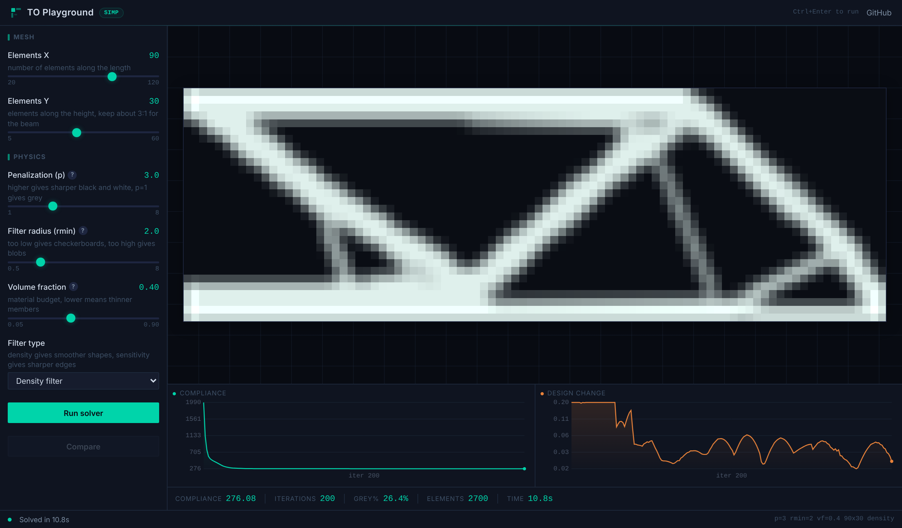
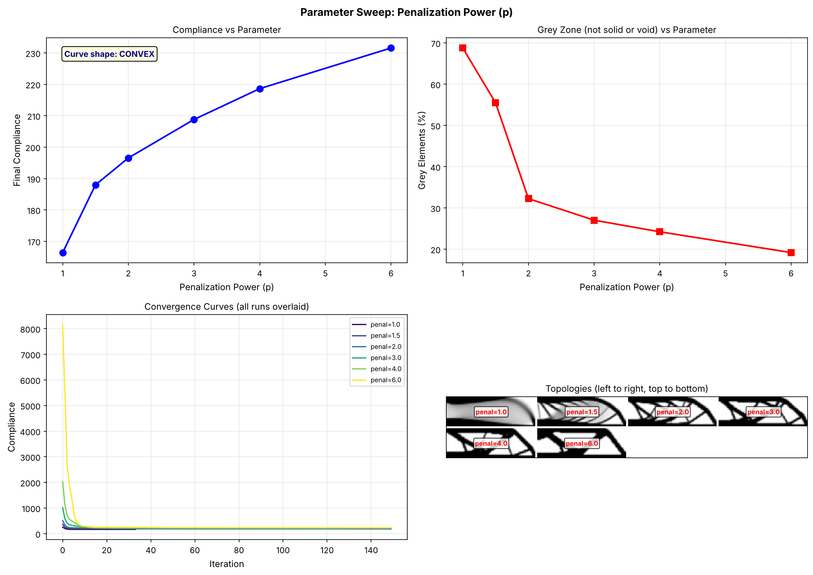
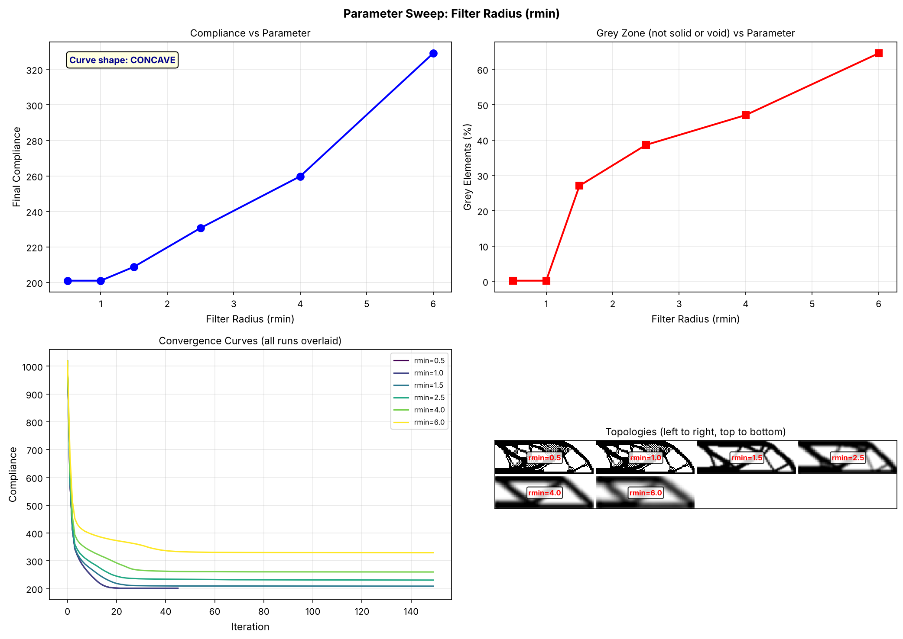
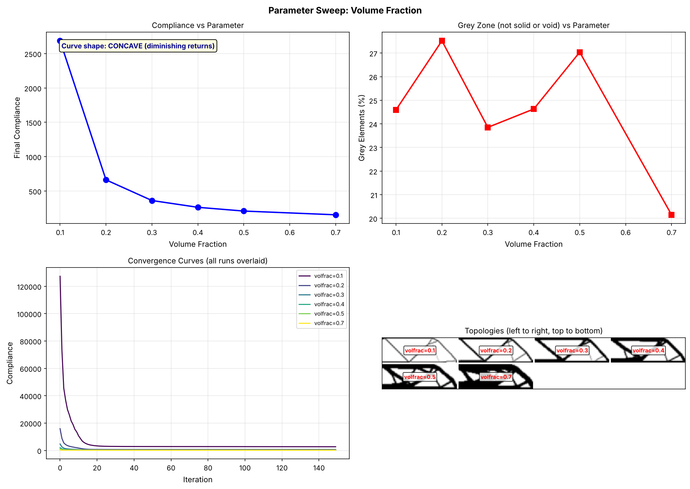

# TO Playground

A 2D topology optimization tool that runs in the browser. The SIMP solver is written in Python and runs through Pyodide, so there is no server and nothing to install.



## What it does

You change the solver parameters, press run, and see the topology the optimizer finds. The idea is to understand what each parameter does on a small 2D problem before running a heavy job in nTop, Fusion or any other TO tool.

The load case is the half MBB beam:
- point load at the top left
- left edge is the symmetry line (x fixed)
- roller support at the bottom right corner (y fixed)

## Parameters

**Penalization (p)** pushes each element to be fully solid or fully empty. At p=1 you get a grey result. At p=3 the result is mostly black and white. Higher values can get stuck in a local minimum.

**Filter radius (rmin)** is how far the density smoothing reaches, in elements. Small values give more freedom but can give checkerboard patterns. Large values give smooth, thick members but the stiffness is a bit worse.

**Volume fraction** is the material budget. Lower values give thinner members and more interesting shapes, but higher compliance.

**Mesh (nelx x nely)** is the number of elements. A finer mesh shows more detail but takes longer. Start at 60x20 and go finer once you find something useful.

**Filter type** can be density or sensitivity. The density filter smooths the density field itself. The sensitivity filter smooths the gradients. The density filter usually gives cleaner results.

## Things to try

1. Set p=1 and run. The result is grey everywhere. Now set p=3 and run again, the members show up clearly.
2. Run with rmin=0.5 and then rmin=6. The first one gives checkerboards, the second one gives blobs. Around 1.5 to 2.5 works for most meshes.
3. Lower the volume fraction from 0.5 to 0.15 step by step and see how members get removed while the load path stays.
4. Run once, press Compare, change one parameter and run again. You get both results side by side.
5. Run the same settings with both filter types and compare the grey %.

## Running it locally

Pyodide needs HTTP, so opening the file directly (file://) will not work. Use any static server:

```bash
python -m http.server 8000
```

Then open http://localhost:8000. It can also be hosted as is on GitHub Pages.

The Python scripts need numpy, scipy and matplotlib:

```bash
pip install -r requirements.txt
python simp_solver.py     # single run with plots
python param_sweep.py     # sweeps p, rmin and volfrac, saves plots to images/
```

## Files

```
index.html        the app (single file, no build step)
solver_web.py     SIMP solver for Pyodide, no matplotlib
simp_solver.py    full solver with plots, for local use
param_sweep.py    parameter sweeps, writes the plots in images/
images/           app screenshot and sweep results
```

## Parameter sweeps

These come from `param_sweep.py` on a 90x30 mesh.





## Solver

It follows the 88-line SIMP code by Andreassen et al. (2011), with both filter types added. The update uses the optimality criteria (OC) method with bisection on the Lagrange multiplier. It stops when the max element change is below 0.01 or after 200 iterations.

`solver_web.py` uses the same algorithm as `simp_solver.py` without matplotlib. It returns the density field and the convergence history, and the page draws them on a canvas.

## Speed

The first load takes about 5 to 10 s because Pyodide has to download numpy and scipy. After that, rough solve times:
- 60x20: 2 to 5 s
- 90x30: 10 to 20 s
- 120x40: 30 to 60 s

It depends on your machine and the parameters.

## Credits

Andreassen, E., Clausen, A., Schevenels, M., Lazarov, B. S. and Sigmund, O. (2011). Efficient topology optimization in MATLAB using 88 lines of code. Structural and Multidisciplinary Optimization, 43(1), 1-16.

## License

MIT, see [LICENSE](LICENSE).
